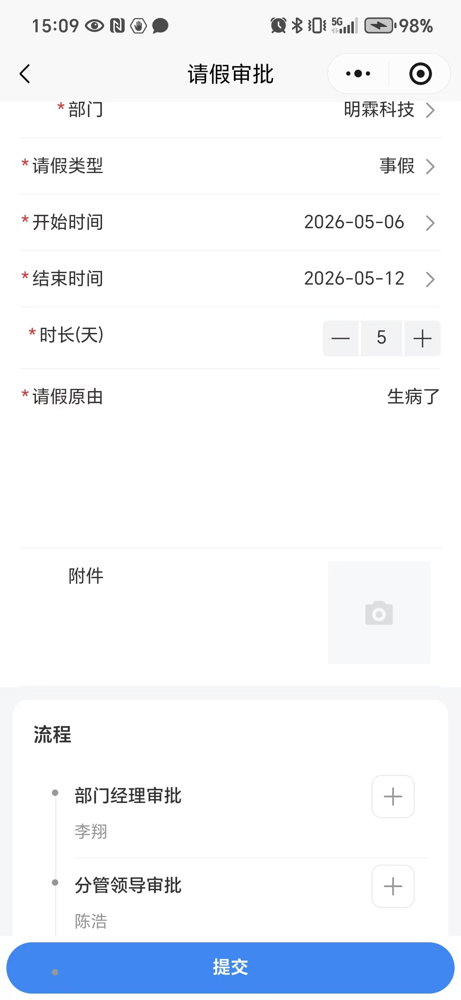
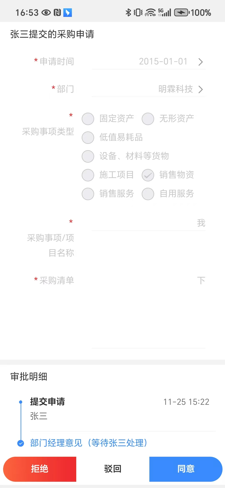
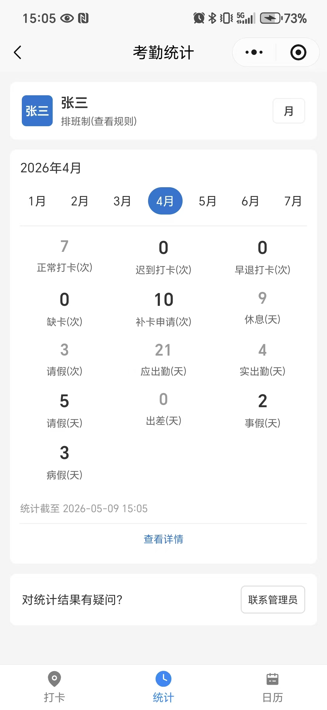

# 明霖OA系统

## 一、产品简介

​    	基于开源流程引擎camunda开发的办公自动化系统，支持OA审批、业务申请，考勤支持多段班、三班倒、大小周，缺卡补卡，请假、出差等审批流程，私信、群聊、单人音视频、多人音视频聊天、AI应用门户、AI大模型、MCP、AI知识库、AI流程设计、AI工具箱。采用前后端分离架构，基于可视化的表单建模、流程建模工具，零代码快速构建业务OA应用。

## 二、采用技术方案

主要采用的技术如下：

| 序号 | 技术名称                             | 版本号                       |
| :--: | ------------------------------------ | :--------------------------- |
|  1   | Vue3                                 | 3.5.22                       |
|  2   | Vite                                 | 6.4.0                        |
|  3   | ant-design-vue                       | 4.2.6                        |
|  4   | springboot                           | 3.5.5                        |
|  5   | jeecgboot                            | 3.9.1                        |
|  6   | minio                                | RELEASE.2023-04-13T03-08-07Z |
|  7   | camunda                              | 7.24.0                       |
|  8   | uview-ui                             | 4.2.3                        |
|  9   | uni-ui                               | 1.5.7                        |
|  10  | MySQL                                | 8.0.40                       |
|  11  | form-create/ant-design-vue(PC端表单) | 3.2.38                       |
|  12  | bpmn-js                              | 7.5.0                        |
|  13  | unipush                              | 2.0                          |
|  14  | jdk                                  | 17.0.16                      |
|  15  | node.js                              | 20.15.0                      |
|  16  | pnpm                                 | 10.18.3                      |
|  17  | WebRTC                               | —                            |
|  18  | coturn                               | 4.6.2                        |
|  19  | @form-create/vant(移动端表单)        | 3.2.41                       |
|  20  | vant(移动端表单UI)                   | 4.9.24                       |

## 三、开发环境

1. 操作系统：MacBook Pro
2. 数据库：MySQL
3. Web服务器：Nginx
4. 缓存redis，文件存储minio
5. 开发工具：Webstorm，idea，HbuilderX

## 四、产品演示

PC端：   

   [管理端：](https://www.minglina.com/oa)   账号密码：admin/Aa123456@admin

   [h5端：](https://www.minglina.com/oah5)  账号密码：zhangsan/Aa123456@zhangsan

安卓app安装包：[oa.apk](install/oa.apk)

小程序截图：  

|   |   |   |
| ------------------------------------------------------------ | ------------------------------------------------------------ | ------------------------------------------------------------ |
|                    |                    |                    |
|                    |                    |                    |
|  |  |  |
|   |                   |                   |

 扫码体验：       

## 五、功能说明

### 1.**OA审批**

#### **我的发起**

​		在发起列表中，可以看到历史申请的详细信息，包括当前所处环节、办理人、流程状态、发起时间等。

​		选择发起的申请，点击进入详细页面。在详细页面中，可以查看申请的详细内容、审批流程情况等。

​		可以根据需要撤销已提交的申请。

#### **我的待办**

​		在待办列表中，可以看到所有待办事项的详细信息，包括待办事项的类型、发起人、发起时间等。选择要处理的待办事项，点击进入详细页面。在详细页面中，可以查看任务的详细内容、审批流程和历史记录等。

​		可以随时查看自己的待办事项的状态和处理情况，并根据需要进行跟进。

#### **我的已办**

​		根据需要对已办事项进行筛选查询，以便更好地管理和查看任务。

​		选择要查看的已办事项，点击进入详细页面。在详细页面中，可以查看任务的详细内容、审批流程和历史记录等。

### 2.OA申请

​     预设的一些审批流程。

### 3.**流程管理**

#### **表单设计**

​		在线可视化表单设计器，拖拽式设计业务表单，组件类型丰富，自定义表单样式，可快速构建业务表单，表单设计器包含表单组件、辅助组件、布局组件、系统组件等多种组件，可构建复杂页面功能，支持表单预览，所见即所得。

​		基于设计的表单动态生成业务实体表，页面设计完成后，发布即可完成对应表单的数据库表结构设计。操作简单，业务人员能够快速上手。

#### **流程设计**

​		BPMN2.0规范，基于开源camunda流程引擎开发，支持浏览器在线设计流程，驳回、拒绝、撤销等多种中国特色流程操作。

支持流程节点和设计的表单绑定。流程设计完成，发布部署流程。

#### **执行监听**

​		系统内置了表达式和Java类两种监听类型，支持开发人员扩展，方便业务人员在设计流程时参照，配置节点审批人的获取方式。

####  **流程实例**

​		查看所有发起的流程实例，包含历史流程实例。查看流程实例审批明细，进行中的流程实例可以进行关闭操作。

#### **任务管理**

​		查看当前正在执行中的任务，委派任务给指定的人办理。

### 4. “班次”与“考勤组”

- **班次**：现在可以自由配置多段上下班时间，比如“上午班+下午班+晚班”。系统会自动识别是否跨天（次日），彻底解决了夜班、跨日凌晨打卡的混乱难题。

- **考勤组**：你可以为不同部门、不同岗位的人员，设置不同的考勤规则。比如，行政用固定班次，产线用轮班排班。每个考勤组可独立设置打卡地点、有效范围、是否允许外勤等，管理颗粒度更细、更灵活。

  

------

### 5.智能打卡

系统会根据排班，**自动判断**：

- 今天是否需要为**昨天的班次**打下班卡？
- 当前时间，应该打上班卡还是下班卡？如果是多段班次，又该打哪一段？

规则生效后，员工打开打卡页面，一切清晰明了。再也不用自己琢磨“我今天是早班还是晚班”、“这时候打卡算不算迟到”，系统替你算好了。

------

### 6.排班管理

管理员朋友，这次给你们准备的“武器”也升级了。

1. **在线表格编辑**：在系统内直接像操作Excel一样灵活排班，直观又便捷。

2. **导入/导出**：你可以下载模板，在本地Excel中批量编排好月度排班，然后一键导入系统。效率翻倍，尤其适合大规模排班场景。

   

------

### 7.一目了然的考勤日历

除了强大的排班工具，我们全新引入了**可视化考勤日历**功能。现在，复杂的排班与出勤状况，可以在一张日历视图上一目了然。

- **个人视角**：每位员工都能清晰查看自己全月的班次安排、打卡结果（正常、迟到、缺卡等），方便提前规划与自查。
- **管理视角**：管理员可以快速切换，总览整个部门或考勤组的出勤分布与异常状态（如大量缺勤集中在某天），管理效率大幅提升。点击日历中的任意一天，即可快速进入详情处理。

这让考勤管理从未如此直观、高效。

### 8.统计报表

每日、每月的打卡情况，系统自动完成统计计算。

- 迟到、早退、缺卡、加班时长……自动生成，一目了然。

- 支持多维度的考勤报表，为薪资核算提供精准依据，大大减轻HR月末对账的负担。

  

##  七、咨询

1. 邮箱：[1041114134@qq.com](https://gitee.com/link?target=mailto%3A1041114134%40qq.com) 。
2. 联系微信：FinelyYang，或扫码加作者好友。

 

 
