### 明霖OA

##  一、产品简介

​    	基于开源流程引擎camunda开发的办公自动化系统。采用前后端分离架构，基于可视化的表单建模、流程建模工具，零代码快速构建业务OA应用。

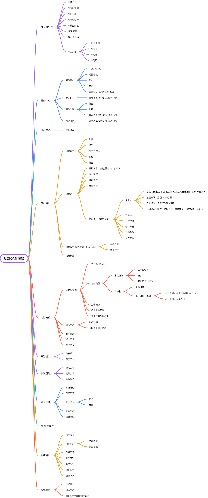

## 二、采用技术方案

主要采用的技术如下：

| 序号 | 技术名称       | 版本号                       |
| ---- | -------------- | ---------------------------- |
| 1    | Vue3           | 3.4.27                       |
| 2    | Vite           | 5.3.0                        |
| 3    | ant-design-vue | 4.2.3                        |
| 4    | springboot     | 2.7.18                       |
| 5    | jeecgboot      | 3.7.1                        |
| 6    | minio          | RELEASE.2023-04-13T03-08-07Z |
| 7    | camunda        | 7.17.0                       |
| 8    | uview-ui       | 4.2.3                        |
| 9    | uni-ui         | 1.5.7                        |
| 10   | MySQL          | 8.0.40                       |
| 11   | form-create    | 3.2.17                       |
| 12   | bpmn-js        | 7.5.0                        |

## 三、开发环境

1. 操作系统：MacBook Pro
2. 数据库：MySQL
3. Web服务器：Nginx
4. 缓存redis，文件存储minio
5. 开发工具：Webstorm，idea，HbuilderX

## 四、产品演示

PC端：   

   [管理端：](https://www.minglina.com/oa)   账号密码：admin/Aa123456@admin

   [h5端：](https://www.minglina.com/oah5)  账号密码：zhangsan/Aa123456@zhangsan

安卓app安装包：[oa.apk](install/oa.apk)

小程序截图：  

|  |  |  |
| ------------------------------------------ | ------------------------------------------ | ------------------------------------------ |
| 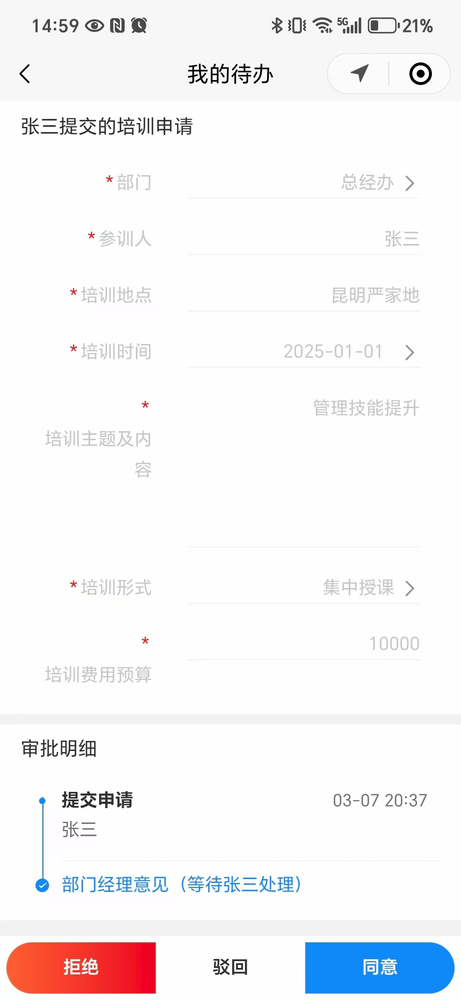 | 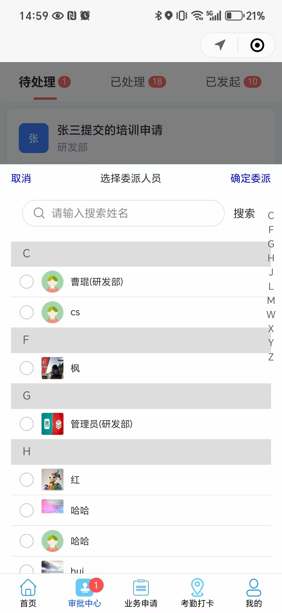 |   |
| 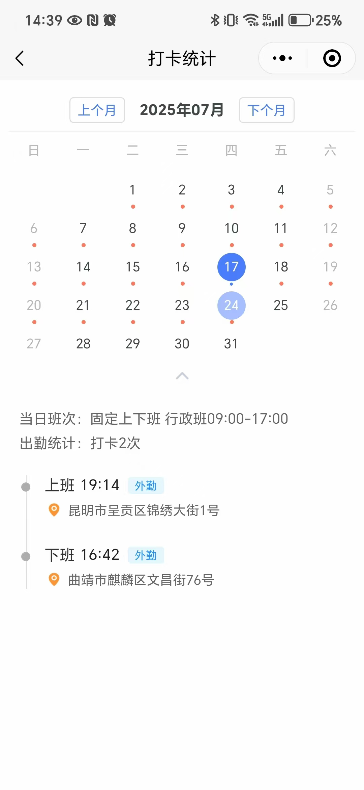 | 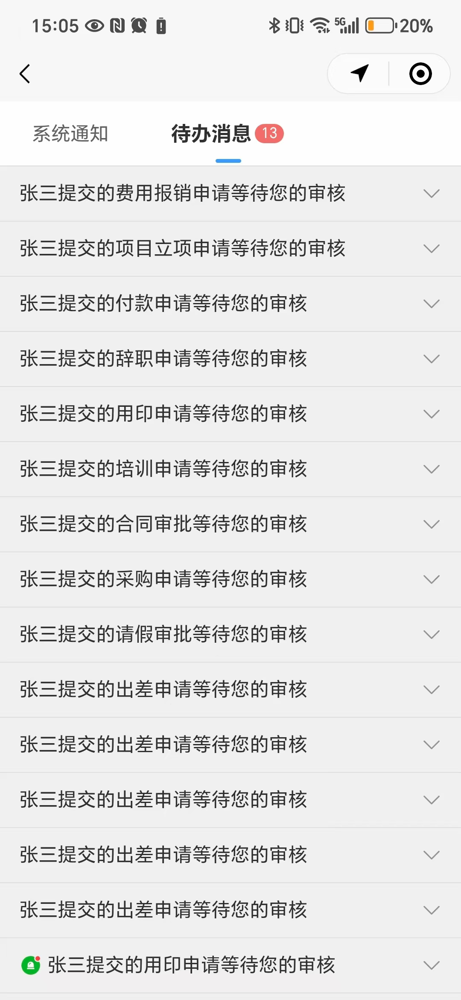 |  |

 扫码体验：       

## 五、功能说明

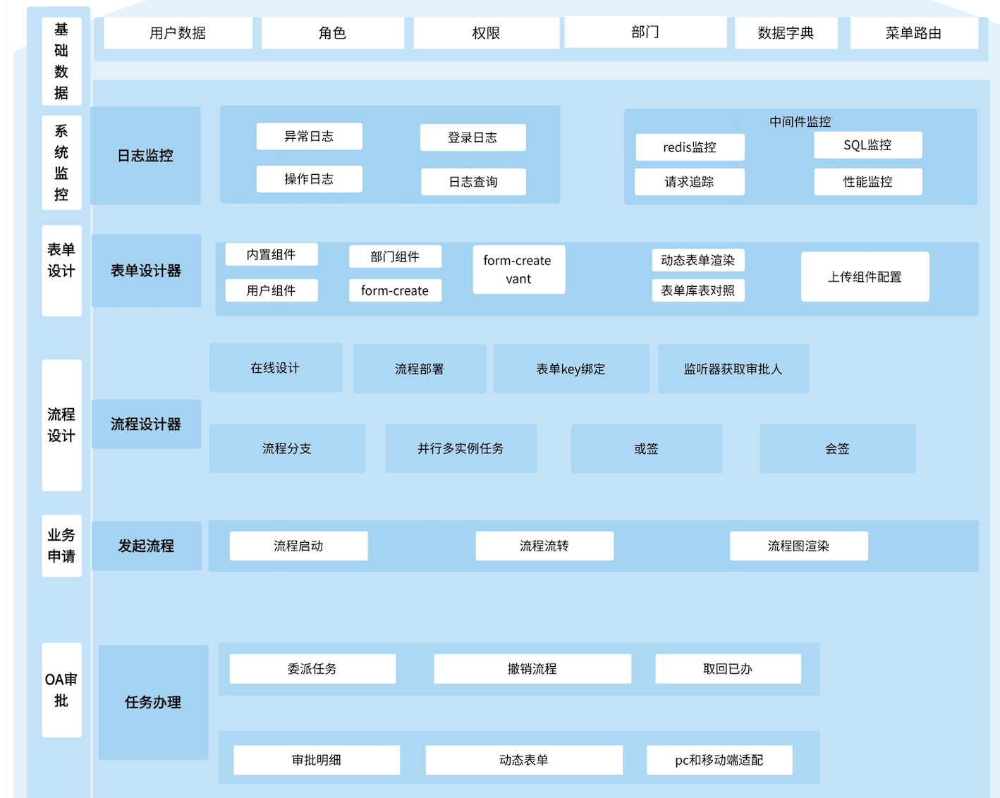

### 1.**OA审批**

#### **我的发起**

​		在发起列表中，可以看到历史申请的详细信息，包括当前所处环节、办理人、流程状态、发起时间等。

​		选择发起的申请，点击进入详细页面。在详细页面中，可以查看申请的详细内容、审批流程情况等。

​		可以根据需要撤销已提交的申请。

#### **我的待办**

​		在待办列表中，可以看到所有待办事项的详细信息，包括待办事项的类型、发起人、发起时间等。选择要处理的待办事项，点击进入详细页面。在详细页面中，可以查看任务的详细内容、审批流程和历史记录等。

​		可以随时查看自己的待办事项的状态和处理情况，并根据需要进行跟进。

#### **我的已办**

​		根据需要对已办事项进行筛选查询，以便更好地管理和查看任务。

​		选择要查看的已办事项，点击进入详细页面。在详细页面中，可以查看任务的详细内容、审批流程和历史记录等。

### 2.OA申请

​     预设的一些审批流程。

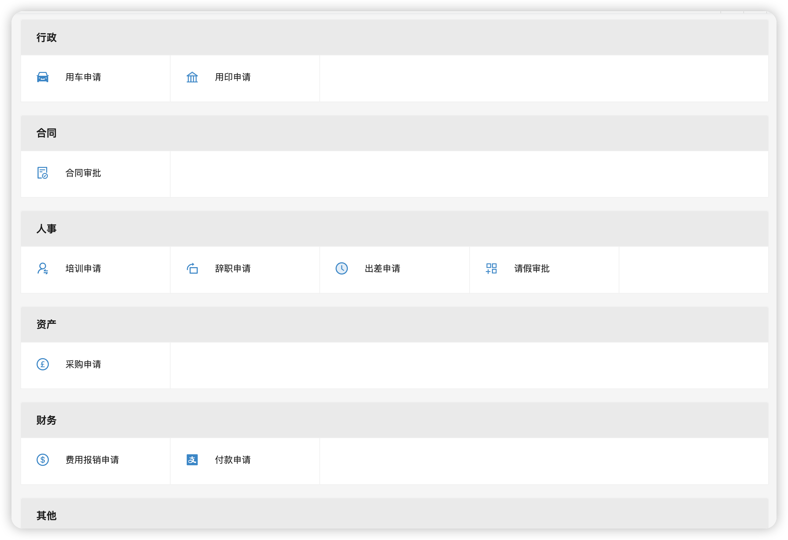

### 3.**流程管理**

#### **表单设计**

​		在线可视化表单设计器，拖拽式设计业务表单，组件类型丰富，自定义表单样式，可快速构建业务表单，表单设计器包含表单组件、辅助组件、布局组件、系统组件等多种组件，可构建复杂页面功能，支持表单预览，所见即所得。

​		基于设计的表单动态生成业务实体表，页面设计完成后，发布即可完成对应表单的数据库表结构设计。操作简单，业务人员能够快速上手。

#### **流程设计**

​		BPMN2.0规范，基于开源camunda流程引擎开发，支持浏览器在线设计流程，驳回、拒绝、撤销等多种中国特色流程操作。

支持流程节点和设计的表单绑定。流程设计完成，发布部署流程。

#### **执行监听**

​		系统内置了表达式和Java类两种监听类型，支持开发人员扩展，方便业务人员在设计流程时参照，配置节点审批人的获取方式。

####  **流程实例**

​		查看所有发起的流程实例，包含历史流程实例。查看流程实例审批明细，进行中的流程实例可以进行关闭操作。

#### **任务管理**

​		查看当前正在执行中的任务，委派任务给指定的人办理。

## 六、使用说明

####  **1.表单设计**

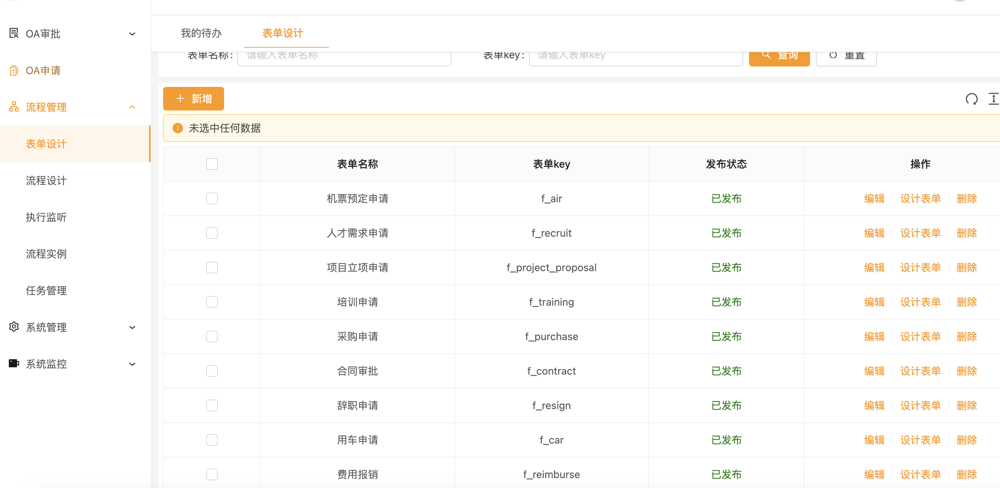

​		在“流程管理”-“表单设计”菜单，新建自定义表单。表单key需以“f_”开头，且不能重复。 

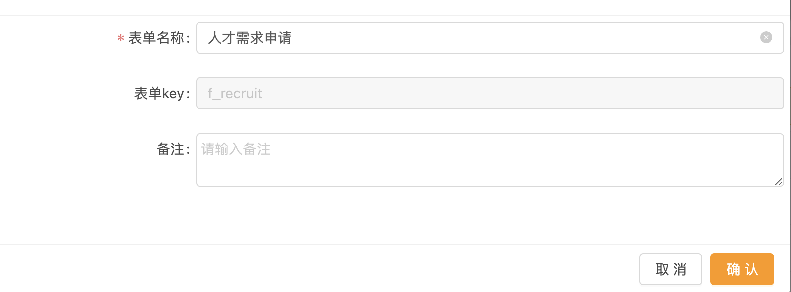

新建完成后，点击“设计表单”，然后根据业务设计表单。

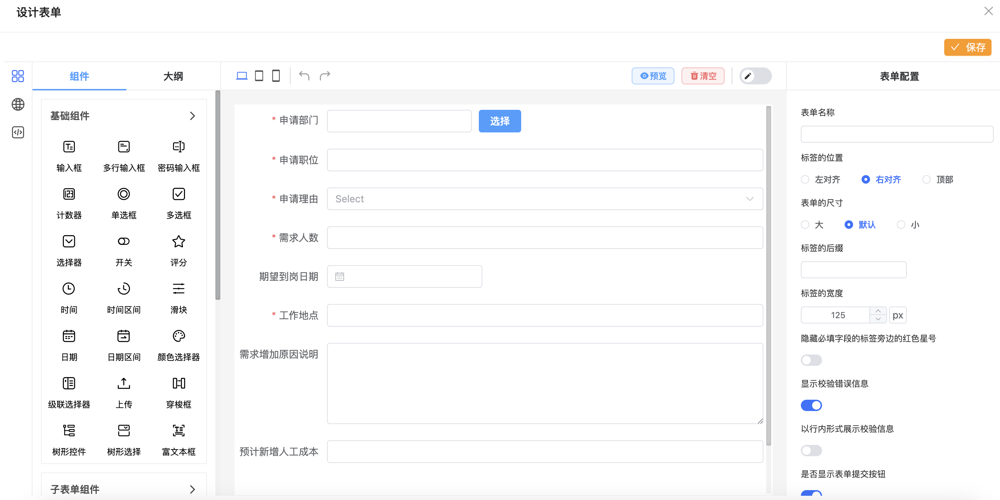

表单中，每一项的**字段ID必填，不允许重复**。为了易理解，请修改为见文知意的id，该id在建表时会作为业务表的字段名称。

系统还内置了几种常用的组件，方便业务人员在设计表单时直接拖拽使用。

表单设计完成系统自动判断是否需要发布，点击发布按钮，自动更新业务表结构。

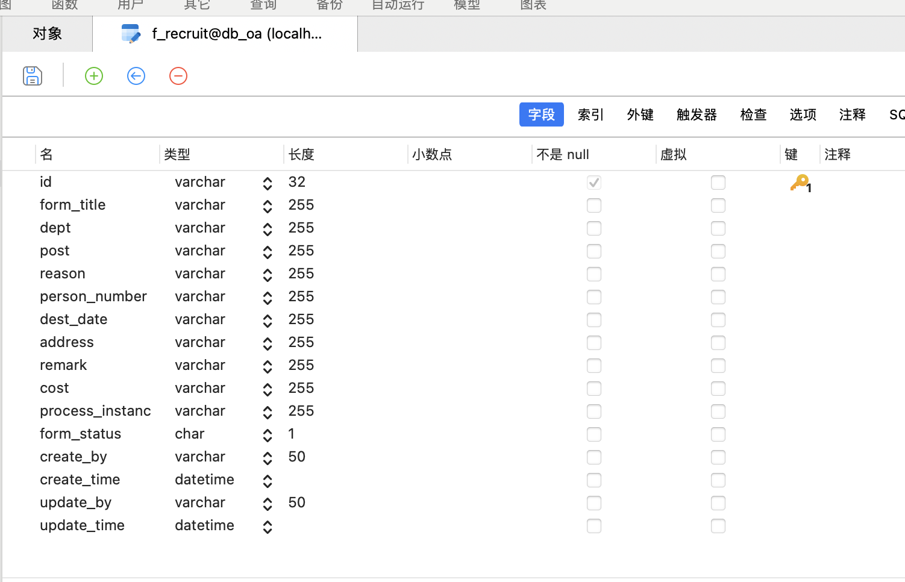

#### 2.**流程设计**

​		在“流程管理”-“流程设计”菜单，新建流程。

新建完成后，点击“设计流程”，然后根据业务设计流程。

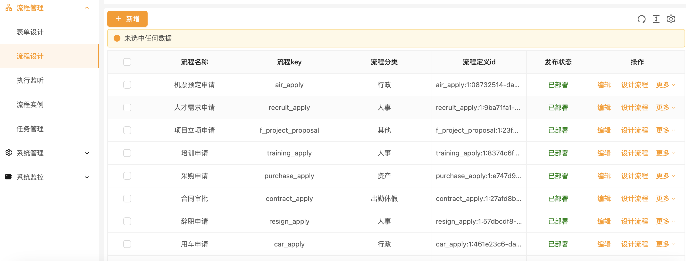

设计的流程图如下：

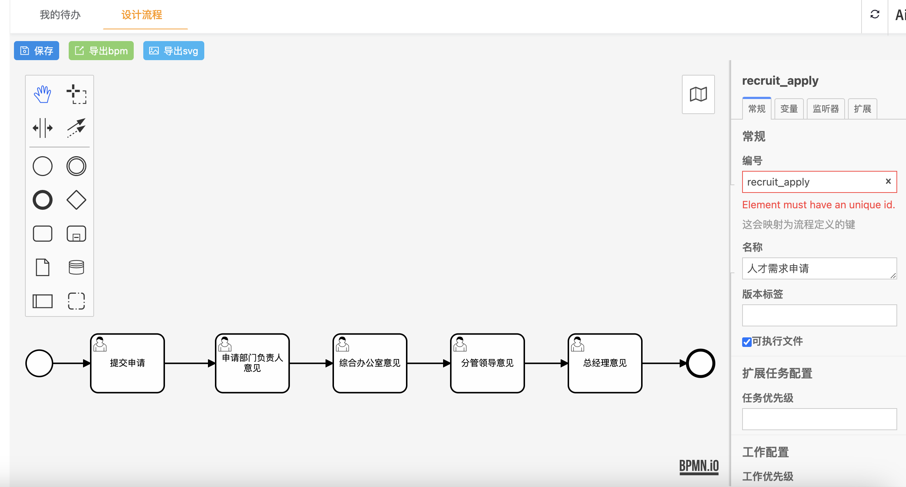

流程的编号即流程定义key，很重要，需唯一。

（一）开始节点：

创建者为：starter，这个流程变量表示流程发起人，在“提交申请”节点用到。

  

（1）***开始节点的表单key必须配置，即配置表单设计填入的f_开头的key。***

（2）开始节点表单key为自定义表单时，其他节点不能再设置另外的表单key（即必须与开始节点的表单key一致）。

（二）提交申请：

代理人从流程变量starter自动取值。程序内部做了控制判断，会自动完成该节点的审批。

**提交申请节点的表单key和开始节点保持一致，方便驳回时再次填写表单**。

  

（三）部门经理审批和总经理审批

均不需设置表单的key。审批流转到此两节点时会加载开始节点的表单，并嵌入审批的页面。

节点没有设置审批人，则需要到“任务管理”委派任务指定新的办理人。

节点可以通过代理表达式的方式设置审批人。

表达式的配置方法：

查询申请人所属部门内的指定角色人员：${flowExpression.getDepartUserByRole(roleCode)}，roleCode: 角色编码，请在角色管理查看角色编码。

查询申请人所属单位内的指定角色人员：${flowExpression.getOrgUserByRole(roleCode)}，roleCode: 角色编码，请在角色管理查看角色编码。

如果负责人只有一个，请配置在代理人(assignee)；如果为多个，请配置在候选用户(candidate users)。如果不能确定负责人是一个还是多个请配置在候选用户(candidate users)。

同意和驳回：

连线上配置，opinion值，1表示同意，2表示驳回。

同意的表达式配置如下图所示：

驳回需要注意在连线上的名称只能为“驳回”，提交表单时程序会判断是否配置“驳回”的逻辑，如果配置了，驳回时就会流转到配置的节点，如果没有配置则驳回到开始节点的下一个用户任务节点，此处即“提交申请”节点。

驳回的表达式配置如下图所示：

条件判断：

${day>3}：***day是流程变量，从设计的表单而来***。如果流程流转到当前环节的所有表单中都找不到这个流程变量的话，流程将会异常结束，这个情况需要注意。  

审批人除了使用表达式或者Java类外，还可以直接指定审批人用户名。

#### 3.流程部署

​		流程设计完成后，保存流程。  

保存成功后，部署流程。

#### 4.发起流程及流转

​		在“OA申请”菜单，点击“自定义表单审批”。

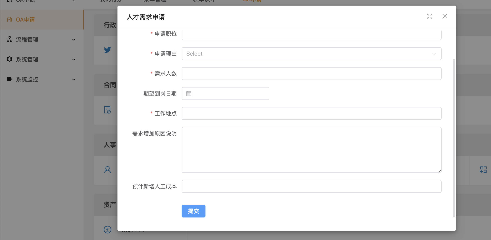

填写表单，点击“提交”。

如果没有配置过办理人，到任务管理，委派任务。

张三的账号登录后，即可在“待办管理”-“我的待办”，看到待办任务，处理即可。

选择审批结论后，系统会自动获取下一环节办理人，允许重新指定办理人。

使用系统管理员账号登录后，处理待办任务。

可以在“我的发起”中查看流程流转详情。

至此，流程审批完成。

##  七、咨询

1. 邮箱：[1041114134@qq.com](https://gitee.com/link?target=mailto%3A1041114134%40qq.com) 。
2. 联系微信：FinelyYang，或扫码加作者好友。

 

 
